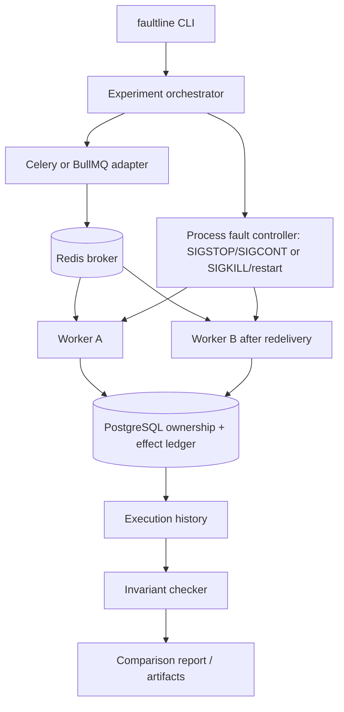

# Faultline: architecture, failure timeline, and correctness boundaries

**What it is:** a repeatable failure-injection harness for at-least-once background workers, using real Celery/BullMQ integrations, Redis, and PostgreSQL.  
**Primary question:** when does a recovered or redelivered task create duplicate effects, and which guard actually prevents them?

> The project is **Jepsen-inspired**, not Jepsen itself. Its experiments establish narrow, testable properties under controlled failures; they do not prove exactly-once execution for arbitrary applications.

## Architecture



The CLI/orchestrator chooses a worker adapter and fault/window, drives the real workers, records database history, and evaluates a correctness property. Adapter abstraction prevents the benchmark from being hard-wired to one worker framework while preserving broker-specific semantics.

Public repository entry points include `faultline/cli.py`, `faultline/history.py`, `faultline/adapters/`, `faultline/faults/process.py`, `faultline/invariants/effects.py`, `faultline/reporting/compare.py`, and `faultline/scenarios/ambiguous_remote.py`.

## Failure 1: stale worker ownership after redelivery

At-least-once delivery means the broker may deliver the same logical task more than once. This is not automatically wrong; it becomes a correctness bug if duplicate executions both commit a non-repeatable effect.

```text
T1 Worker A gets job; receives ownership token 1
T2 A reaches the pre-commit window; harness sends SIGSTOP
T3 Redis visibility timeout permits redelivery
T4 Worker B gets the same job; obtains newer token 2
T5 B commits the local effect in PostgreSQL
T6 Harness resumes A with SIGCONT
T7 A attempts commit while still presenting token 1
```

### What fencing changes

The controlled experiment's protected path uses a PostgreSQL transaction, locks the job ownership row with `SELECT ... FOR UPDATE`, reads `current_token`, and compares it to the worker's presented token. The stale A token is refused *at commit*, even if A did not know its lease/ownership was superseded.

A simplified **illustrative** transaction (not a verbatim copy of implementation code):

```sql
BEGIN;
SELECT current_token FROM job_ownership WHERE job_id = :job_id FOR UPDATE;
-- Application logic: reject when supplied_token != current_token.
-- Otherwise record the permitted local effect atomically in the same transaction.
COMMIT;
```

The `FOR UPDATE` lock makes the read/decision/commit path serialize against competing ownership/effect updates **when all relevant updates follow the transaction discipline**. It is **not** enforced by a supposed `UNIQUE(job_id, fencing_token)` constraint. A fencing token alone also does not stop an already-performed external API call.

### Documented local-effect result

| Property | Unsafe | Fenced |
|---|---:|---:|
| Committed effects | 2 | 1 |
| Stale rejections | 0 | 1 |
| At-most-one-effect invariant | FAIL | PASS |

This is from the specified controlled stale-worker scenario, not a fleet-wide production statistic. The CLI described by the README is:

```bash
faultline compare --adapter celery --fault pause --invariant at-most-one-effect
```

## Failure 2: the remote effect succeeded but the acknowledgment was lost

The more subtle failure is **not stale ownership**.

```text
Worker A -> remote test charge service: charge(idempotency_key?)
Remote service -> performs charge
A is SIGKILLed before seeing the successful response
Worker B gets a legitimate redelivery and holds the current token
B retries the remote call: is it a retry or a second charge?
```

Fencing cannot tell Worker B that the first remote operation already happened: Worker B is not stale. A locally committed ownership check cannot atomically encompass an unrelated remote service without additional distributed coordination. The project exercises the separate **receiver-side idempotency** solution.

| Strategy | Observed external effects | Result |
|---|---:|---|
| Naive | 2 | Duplicate effect |
| Fencing only | 2 | Duplicate effect |
| Idempotency only | 1 | Duplicate suppressed |
| Fencing + idempotency | 1 | Duplicate suppressed |

The charge service is a **controlled test service**. This is not evidence of real customer payments or production financial transactions.

Reproduction commands documented in the README:

```bash
python -m faultline.scenarios.ambiguous_remote --strategy fencing
python -m faultline.scenarios.ambiguous_remote --strategy fencing-idempotency
```

### Why idempotency must be enforced at the right boundary

An idempotency key is meaningful only when the component that performs the side effect can reliably recognize repeated requests and return or reuse the outcome. The sender cannot guarantee remote exactly-once behavior merely by storing that it *intended* to call an API.

For a real system, you would also have to design key scoping, persistence, TTL/retention, response replay behavior, and transactional storage at the receiver. Faultline's demonstration is **evidence for the controlled case**, not proof that every remote service has those properties.

## What the harness actually validates

The public README lists four invariant checkers:

| Property | Status described by project |
|---|---|
| `at-most-one-effect` | Supported in CLI and exercised in scenarios |
| `stale-owner-cannot-commit` | Reported on Celery runs |
| `no-lost-committed-effect` | Reported on Celery runs |
| `eventually-processed-after-recovery` | Implemented and unit-tested; **not yet driven by a scenario** |

The README notes that `--invariant` currently selects only `at-most-one-effect` and `kill` is supported for the **post-commit** window. Do not imply every invariant, failure type, adapter, and window works in every combination.

## Running and inspecting evidence

Follow the root README's dependencies and Docker setup. From the repository root:

```bash
python3 -m venv .framework-venv
source .framework-venv/bin/activate
python -m pip install -e '.[dev]'

faultline test --adapter celery --fault pause --implementation unsafe --invariant at-most-one-effect
faultline test --adapter celery --fault pause --implementation fenced --invariant at-most-one-effect
python -m pytest tests/ -v
```

The README reports **58 passing tests** covering the described adapters, invariants, CLI, failure windows, and scenarios. That is a **repository-reported snapshot**, not a fresh test run performed for this document. Generated run artifacts are stored separately from curated canonical evidence; retain the exact run parameters and reports when presenting results.

## Architecture decisions and trade-offs

- **Why Redis and PostgreSQL?** Redis provides real broker/redelivery behavior; PostgreSQL supplies transactional ownership and effect history. They play different roles.
- **Why process-level faults?** `SIGSTOP` / `SIGCONT` and `SIGKILL` expose pause/crash windows that pure mocks often elide.
- **Why compare unsafe and protected implementations?** A passing protected run alone cannot establish that the failure injection was capable of exposing the bug. A matching unsafe run provides a useful control.
- **Why not call this “exactly once”?** Delivery may be repeated; the claim is that a particular guard rejects or deduplicates effects in a defined scenario.
- **Why not call it Jepsen?** The harness follows a related test methodology but does not provide Jepsen's full history checking or failure model.

## Explicit non-goals

This is not a universal proof of linearizability, arbitrary distributed transactions, consensus, Byzantine tolerance, comprehensive broker certification, or protection from every external side effect. The project currently focuses on reproducible failure windows that make the **limits of each correctness mechanism visible**.
